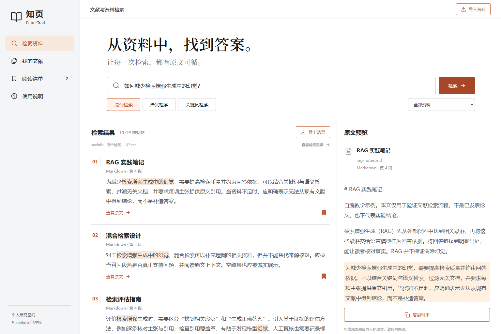

# 知页 · PaperTrail

## 版本入口

| 版本 | 目录 | 来源与当前状态 |
| --- | --- | --- |
| **Qoder 正式版本（比赛主版本）** | [`papertrail/`](papertrail/) | 本次 Qoder 会话新建的独立前后端、数据模型与验收；默认端口 8791，数据库 `qoder_papertrail_qoder` |
| **Codex 原型（历史参考）** | 本目录根级 `server/`、`src/` 等 | 先前 Codex 会话实现；默认端口 8790，只作为需求、视觉和接口参考 |

正式版本请从 **[papertrail/README.md](papertrail/README.md)** 开始。最新实测为单元 6/6、真实 seekdb 接口 34/34、应用与数据库重启持久化 9/9、桌面与手机浏览器 19/19 通过；原始结果和边界见 [正式版验收说明](papertrail/docs/VALIDATION.md)。本次实际开发过程见 [Qoder 开发记录](docs/QODER_DEVELOPMENT.md)。


本阶段未发布 Qoder Sites，也未向远端推送。旧原型及其文档继续保留，不与正式版本证据混用。

---

## Codex 原型历史说明

从论文、课程笔记和实验记录中找到相关段落，再回到原文核对出处。支持 PDF / Markdown / TXT 导入，中英多语言语义检索、关键词检索和 seekdb 混合检索，原文预览、片段收藏与引用导出。



### 原型状态与比赛要求

代码位于 `2026-competition-ecosystem` 分支的 `qoder/`。本目录根级应用是先前 **Codex** 会话实现的可运行原型，不属于 Qoder 开发证据；Qoder 正式版本已按上方入口单独完成。

| 事项 | 当前状态 |
| --- | --- |
| 原型本地应用与实际 seekdb 检索 | 已实现，见原型测试与真实操作记录 |
| 原型样例、运行说明、界面截图 | 已提供，均为历史参考 |
| Qoder 正式版本开发 | 已完成本机实现与验证，见新版入口和真实开发记录 |
| Qoder 账号 UID | 待参赛者填写 |
| Qoder Sites 公开站点 | 尚未发布，见 [发布交接](docs/QODER_HANDOFF.md) |
| 真实用户使用效果 | 未采集，不以本机测试替代 |

项目尚不能直接宣称满足全部赛事提交要求。不要提交虚构的 UID、站点地址、开发截图或提效数据。

## 运行环境

- Windows 11、macOS 或 Linux；Node.js **24.5+**，npm 11；Chrome / Edge 等现代浏览器。
- Docker Desktop（Linux 容器）或已有 seekdb **1.4+** 实例。建议至少 4 核、8 GiB 可用内存和 10 GiB 空闲磁盘；数据库与模型同时运行需要内存。
- 首次安装联网访问 npm；首次导入/语义检索联网下载约 118 MB 的量化模型和约 17 MB 的 tokenizer。下载完成后复用 `.cache/models`；文献文本在本机推理，不发送给模型服务。无推理 API Key。
- 依赖固定在 `package-lock.json`；seekdb Docker 镜像固定到已验证的 digest，避免 `latest` 漂移。

下列命令均在此 `qoder` 目录执行。

### 1. 启动 seekdb

```sh
docker compose up -d
docker compose logs -f seekdb
```

日志出现 `Seekdb started` / `Initialization complete` 后，按 Ctrl+C 退出日志跟随；数据库继续后台运行。首次初始化可能需要几十秒。

默认仅绑定 `127.0.0.1:2883`，数据保存在 Docker 命名卷。使用官方服务端镜像，seekdb 实际版本为 `seekdb-v1.4.0.0`。如本机已有此项目的 seekdb 容器正在使用 2883 端口，直接复用该实例，无需再启动第二个容器。本次开发环境的手动容器名称为 `qoder-papertrail-seekdb`，可用 `docker start qoder-papertrail-seekdb` 恢复。

已有数据库时可跳过 Docker，在 `.env` 设置连接信息。应用自动创建独立的 `qoder_papertrail` 数据库，不修改其他项目的库；该用户须拥有建库、建表与索引权限。

### 2. 安装、配置和构建

```sh
npm ci
```

PowerShell：

```powershell
Copy-Item .env.example .env
npm run build
npm start
```

macOS / Linux：

```sh
cp .env.example .env
npm run build
npm start
```

打开 **http://127.0.0.1:8790/**。程序仅监听本机；当前是单人资料空间，未提供公网多用户认证。

`.env` 使用占位配置，不含实际密钥。默认数据库连接为 `127.0.0.1:2883 / root / 空密码`，只用于独立本机演示。如使用自己的实例，请填写实际配置。程序通过 Node 的 `--env-file-if-exists` 加载 `.env`。如更改模型 revision，请使用新的 `SEEKDB_DATABASE` 并重新导入，避免混用不同版本的文献向量与查询向量。

### 3. 完成第一次检索

1. 首次打开资料库为空，点击「导入示例资料」。首次模型加载可能需要几分钟，等待导入完成。
2. 搜索「如何减少检索增强生成中的幻觉？」。可切换「混合检索」「语义检索」「关键词检索」。
3. 点击结果的「查看原文」，核对原始段落及上下文；「复制引用」会带上文件名、页码/段落、片段编号。
4. 点击书签加入阅读清单，刷新后仍可查看；「导出结果」下载 Markdown。
5. 点击「查看检索记录」，可看到真实的 seekdb 调用方式、结果片段 ID、模型版本与耗时，并导出 JSON。

三篇样例均为项目自编教学内容，不是已发表论文，不包含虚构实验结果。具体预期见 [验证样例](docs/VALIDATION.md)。

## 功能边界

- 每批最多 8 个文件；单个最多 10 MiB、30 万字符；PDF 最多 200 页。UTF-8 文本；扫描 PDF 需先 OCR。
- 使用 SHA-256 内容摘要去重；相同内容不同文件名视作同一文档，并保留首次导入的文件名。
- 按空行划分段落，再按约 420 字符切片。PDF 通常按页面提取为段落；定位基于提取文本，不是 PDF 原始版面或坐标。
- 预览完整源页/文本；高亮定位段落。同一长段落的多个切片共享段落编号，引用另带片段号。
- 全文匹配采用 seekdb IK 分词，不是逐字子串匹配；英文标点、词形变化和中文分词可能影响召回。换用更短术语或语义模式进行对照。
- 语义和混合模式返回最邻近候选，即使查询与资料无关也可能有结果；需阅读原文核对。没有事实正确率承诺，不把距离/排名包装成可信度。
- 工具不生成论文结论，也不访问互联网获取论文。没有 OCR、联网爬取、多人共享或删除文献界面。

## 技术如何实际发挥作用

```text
文件 → PDF/UTF-8 文本提取 → 带页码/段落的片段
     → 本地多语言 MiniLM 编码（384维）
     → seekdb Collection.upsert + refresh_index

查询 → [IK 全文候选] + [HNSW 余弦近邻]
     → seekdb DBMS_HYBRID_SEARCH / RRF
     → 带原文出处的结果 → 收藏与引用导出
```

seekdb 同时保存文档源文本、向量及全文索引、收藏、审计记录。应用没有 SQLite / 内存检索替身。混合候选和 RRF 排序实际在数据库执行；语义模式使用 `Collection.query`，关键词模式只启用 `hybridSearch` 的全文分支。实现见 [server/store.mjs](server/store.mjs)。本项目选择 seekdb，不依赖 PowerContext。

模型固定为 `Xenova/paraphrase-multilingual-MiniLM-L12-v2`，revision `2c4055b12046f11709e9df2c122e59ffbdc2f900`，q8 / mean pooling / L2 normalization，CPU 本地推理。默认输入上限 256 tokens；长文本在编码时仍可能截断。模型来自 [官方模型页](https://huggingface.co/Xenova/paraphrase-multilingual-MiniLM-L12-v2)，不是项目训练成果。

## 验证

保持应用和数据库运行，在第二个终端执行：

```sh
npm test
npm run verify
```

前者执行 6 项文本与输入边界单元测试；后者在**真实 seekdb 和真实模型**上执行 14 项接口验收，导入自编样例、两页 PDF 测试文件和转义测试文本，并留下一个测试收藏。可以重复运行。结果写入 `evidence/verification.json`，只包含本项目的样例与测试材料。

重启应用后执行 `npm run verify:persistence`，检查上一次验收保存的文档和收藏是否仍存在。测试状态在被 Git 忽略的 `.data/verification-state.json`。

浏览器验收（先执行 `npm run verify` 生成测试资料）：

```powershell
# Windows 已安装 Edge 时，无需下载另一套浏览器
$env:PLAYWRIGHT_CHANNEL = 'msedge'
npm run verify:browser
```

其他环境先 `npx playwright install chromium`，再 `npm run verify:browser`。也可设置 `PLAYWRIGHT_CHANNEL=chrome` 使用已安装的 Chrome。脚本验证检索、原文、复制/导出、上传、去重、收藏、转义和移动端，保存真实截图和 JSON 到 `docs/screenshots/`。截图不应被当作 Qoder 过程记录。[本次测试说明](docs/VERIFICATION.md)。

## 常见问题

- **数据库连接失败：** 确认 Docker 日志已就绪、2883 端口未被占用、`.env` 连接配置正确。数据库启动完成后重新 `npm start`。
- **模型下载失败 / fetch failed：** 确认可以访问 Hugging Face；可在 `.env` 配置自己可用的 `HTTPS_PROXY`。启动命令支持 Node 环境代理；不要关闭 TLS 校验。也可将 `HF_ENDPOINT` 改为可信且包含同一固定 revision 的兼容镜像地址。未下载成功时会报错，不会伪装成语义结果。
- **第一次检索慢：** 首次加载本地模型；后续复用进程内模型与磁盘缓存。界面查询显示数据库耗时，审计另记含模型计算的总耗时。
- **npm 提到可选 peer：** `.npmrc` 的 `legacy-peer-deps=true` 用于绕开 SDK 可选默认模型包的 `workspace:*` 发布问题。项目自己提供向量，不会使用该默认模型包。
- **更改前端后未更新：** 运行 `npm run build` 并刷新。开发可在第二终端运行 `npm run dev`，打开 `http://127.0.0.1:5173`。
- **停止运行：** 应用终端 Ctrl+C；Docker Compose 用户执行 `docker compose stop`，下次 `docker compose start`。数据库卷应保留，除非明确要清空资料。

## 目录与提交

`src/` 是 React 界面；`server/` 是本机 API、文本切片、嵌入和 seekdb 集成；`samples/` 是初始资料；`tests/` 是可复现测试；`docs/` 是运行外的验收与 Qoder 交接材料；`evidence/` 是实际功能测试记录。

仓库入口：[sevenmiles666/psfPowerContext](https://github.com/sevenmiles666/psfPowerContext/tree/2026-competition-ecosystem/qoder)。此链接在本地改动推送后才包含本项目；本次不会自动向远端推送。提交材料清单见 [SUBMISSION.md](docs/SUBMISSION.md)，开源来源与改动见 [ATTRIBUTION.md](docs/ATTRIBUTION.md)。
