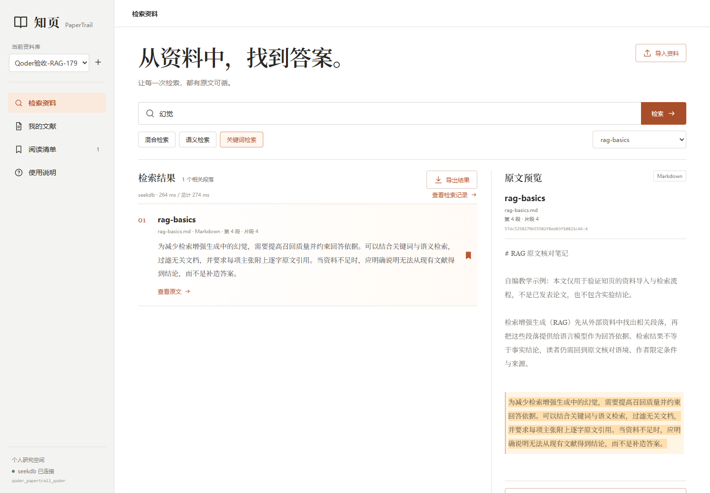

# 知页 PaperTrail · Qoder 正式版本

从论文、课程笔记和研究资料中检索相关段落，再回到完整原文核对出处。核心是**查找证据**，不是生成无出处的论文结论。

本目录是在本次 Qoder 会话中新建的独立实现，不是 `qoder/` 根目录 Codex 原型的改名或复制。默认使用独立端口 `8791` 和独立数据库 `qoder_papertrail_qoder`。



## 已实现功能

- 创建、切换主题资料库；文献、片段、收藏和审计记录均按资料库隔离。
- 导入含可提取文字的 PDF、UTF-8 Markdown 和 TXT；逐文件显示导入、去重或失败结果。
- SHA-256 内容去重；限制批量文件数、单文件大小、PDF 页数和提取文本长度。
- 长段落切片，保存完整源文本及页码、段落号、片段号和逐字字符偏移。
- 真实 seekdb Collection、IK 全文索引、384 维 HNSW 余弦向量索引。
- 关键词、语义、混合三种检索；均可限定当前资料库中的某份文献。
- 混合检索在数据库中融合全文与向量候选，使用 RRF `1 / (60 + branchRank)`，两路候选窗口各为 30。
- 本地 CPU 多语言嵌入，无推理 API Key；固定模型 revision，并阻止不同模型版本混用向量。
- 完整原文预览、精确高亮、稳定片段 ID、逐字引用复制和 Markdown 导出。
- 持久阅读清单、明确确认的库内文献删除、相关片段与收藏清理、重复删除幂等结果。
- 可导出的真实导入、检索、异常和删除记录；检索审计含模型版本、结果 ID、数据库耗时与总耗时。
- 桌面三栏阅读布局和手机纵向布局；手机原文加载后自动滚动到可见位置。

## 技术结构

- 前端：React 19、Vite 7。
- 后端：Node.js 24、Express 5、Multer 2。
- 数据：seekdb 1.4 SDK + mysql2；关系表保存资料库、文献源文本、收藏、审计和模型元数据，Collection 保存片段、元数据、全文与向量索引。
- PDF：PDF.js 6；测试 PDF 由 pdf-lib 真实生成。
- 嵌入：Transformers.js 3.8.1，`Xenova/paraphrase-multilingual-MiniLM-L12-v2`，revision `2c4055b12046f11709e9df2c122e59ffbdc2f900`，q8、mean pooling、L2 normalization、384 维，输入最多 256 tokens。

```text
文件 → 文本提取与切片 → 本地 MiniLM 编码
     → seekdb Collection upsert + refresh_index

查询 → IK 全文候选 / HNSW 向量近邻
     → seekdb hybridSearch 与数据库 RRF
     → 当前资料库结果 → 原文核对、收藏、引用与导出
```

项目选择 seekdb，不依赖 PowerContext，也没有 SQLite 或内存检索替身。数据库不可用时会返回明确错误。

## 运行环境

- Node.js **24.5+** 与 npm。
- 已有 seekdb **1.4+**，或 Docker Desktop（Linux 容器）。
- 首次安装依赖和首次使用语义/混合功能时需要联网；模型下载后复用本地缓存。
- 建议至少 4 核、8 GiB 可用内存。数据库与本地模型同时运行需要内存。

以下命令均在 `qoder/papertrail/` 目录执行。

### 方式一：复用本机比赛专用 seekdb

本次实测复用容器 `qoder-papertrail-seekdb`，地址为 `127.0.0.1:2883`。若该容器已存在但未运行，只启动这个容器：

```sh
docker start qoder-papertrail-seekdb
```

默认配置连接该地址，并自动创建或使用独立的 `qoder_papertrail_qoder` 数据库，不读写旧原型的 `qoder_papertrail` 数据库。数据库用户需要建库、建表和索引权限。

### 方式二：启动独立 Compose 实例

如果本机没有可复用实例，本目录提供独立容器和命名卷，宿主端口使用 **2884**，不会占用旧实例的 2883：

```sh
docker compose up -d
docker compose logs -f seekdb
```

看到 seekdb 初始化完成后按 Ctrl+C 退出日志跟随。此时在 `.env` 中设置：

```dotenv
SEEKDB_PORT=2884
```

Compose 数据保存在 `qoder-papertrail-formal-data` 命名卷。停止数据库使用 `docker compose stop`，不要为普通重启删除卷。

## 安装、配置与启动

```sh
npm ci
```

复制 `.env.example` 为 `.env`，按实际环境修改：

- Windows PowerShell：`Copy-Item .env.example .env`
- macOS / Linux：`cp .env.example .env`

`.env.example` 中的 `YOUR_LOCAL_DATABASE_PASSWORD` 是占位值，必须替换为本机数据库密码。若使用**隔离本机演示实例且 root 确认为空密码**，显式写成：

```dotenv
SEEKDB_PASSWORD=
```

不要把真实密码或其他凭据写入 `.env.example`、源码、证据 JSON 或提交记录；`.env` 已被 Git 忽略。

构建并启动：

```sh
npm run build
npm start
```

打开 **http://127.0.0.1:8791/**。服务默认只监听 `127.0.0.1`，没有公网多用户认证。

前端开发可在两个终端分别运行：

```sh
npm run dev:server
npm run dev
```

Vite 开发地址为 `http://127.0.0.1:5173`，API 代理到 8791。生产模式使用前仍需 `npm run build`。

## 第一次使用

1. 点击「新建资料库」，或使用自动创建的初始资料库。
2. 点击「导入资料」→「导入自编样例」，或选择自己的 PDF / Markdown / TXT。
3. 首次涉及向量时会下载并加载固定模型；界面显示加载状态，后续复用 `.cache/models` 和进程内模型。
4. 搜索 `幻觉`，分别对照关键词、语义和混合模式；也可在右侧限定文献。
5. 点击「查看原文」，核对完整上下文、高亮、文件名、页码/段落和稳定片段 ID。
6. 收藏片段，在「阅读清单」中刷新查看；可复制引用或导出 Markdown。
7. 点击「查看检索记录」，检查真实操作、模型版本、结果 ID 和耗时，并导出 JSON。
8. 在「我的文献」删除测试文献时，确认对话框会显示当前资料库与目标文件。

三份初始样例都在 `samples/`，明确标注为自编教学内容，不是已发表论文，也不包含用户效果数据。

## 实际验收

保持应用与数据库运行，在另一个终端执行：

```sh
npm test
npm run verify
npm run verify:browser
```

- `npm test`：文本、切片、UTF-8、稳定 ID 和引用单元测试。
- `npm run verify`：真实 seekdb 与真实本地模型接口验收；会新建两个独立测试资料库，生成真实两页 PDF、无文字 PDF、异常输入与 HTML 转义样例。
- `npm run verify:browser`：真实 Edge 桌面与手机流程、剪贴板、下载、上传去重、中文文件名、删除、XSS 文本渲染、控制台和布局检查。
- `npm run verify:persistence`：在 `npm run verify` 之后，**实际重启应用和数据库再执行**，检查数据、收藏、索引和删除状态是否保留。脚本本身不会替你重启服务。

Windows 已安装 Edge 时浏览器脚本默认使用 `msedge`。其他系统可先安装 Playwright Chromium，再显式指定：

```sh
npx playwright install chromium
PLAYWRIGHT_CHANNEL=chromium npm run verify:browser
```

也可将 `PLAYWRIGHT_CHANNEL` 设为 `chrome` 使用已安装的 Chrome。

最新实测结果：**单元 6/6、接口 34/34、重启持久化 9/9、浏览器 19/19，全部通过；生产构建成功。** 详细范围、时间和原始结果见 [验收说明](docs/VALIDATION.md) 与 `evidence/*.json`。浏览器测试生成的真实截图位于 `docs/screenshots/`，下载文件写入被 Git 忽略的 `.data/browser-downloads/`。

验收脚本使用自编数据并保留隔离测试资料库，供后续持久化和浏览器检查；它们不是用户量或效果评估。重复执行接口验收会创建新的测试资料库，不会清空个人资料。

## 功能边界与安全说明

- 每批最多 8 个文件；单个最多 10 MiB、300,000 个提取字符；PDF 最多 200 页。
- 相同文本即使文件名不同也视为重复；同一内容可分别导入不同资料库。
- 按空行划分段落，再按约 420 字符切片。PDF 定位基于提取文本，不是原始版面坐标。
- 空白文件、不支持格式和无文字 PDF 会明确失败；扫描 PDF 需要先 OCR，本项目不提供 OCR。
- IK 全文检索不是逐字子串匹配；中文分词、英文词形与标点会影响召回。
- 语义和混合模式可能为无关查询返回最邻近候选；排序分与距离不是事实可信度，必须核对原文。
- 长文本嵌入可能因 256 tokens 上限被截断；完整源文本仍保留用于阅读。
- 当前为本机单人应用，不含账号体系、多人共享、联网论文抓取或公网托管。
- React 将导入的 HTML/脚本字符串作为文本渲染，不使用 `dangerouslySetInnerHTML`；API 校验 Host、Origin、ID、JSON 与上传限制。
- 尚未开展真实用户效果评估，不展示虚构提效数字。

## 目录

```text
server/      本机 API、文本提取、切片、本地嵌入、seekdb 与业务一致性
src/         React 检索、原文、文献、阅读清单和对话框界面
samples/     明确标注的自编教学样例
tests/       单元、接口、持久化与 Playwright 验收
evidence/    本次真实验收 JSON
docs/        验收说明与真实运行截图
```

项目展示站点已通过 Qoder Sites 发布并设为公开访问：**https://zhiye-papertrail-dtwmawby435.qoder.website/**（2026-10-30 发布）。该站点展示真实界面截图、验收证据、可下载样例与运行说明；应用本身仍是本机服务，线上站点不提供在线检索后端。代码尚未向远端推送。Qoder 开发过程记录见 [`../docs/QODER_DEVELOPMENT.md`](../docs/QODER_DEVELOPMENT.md)。
