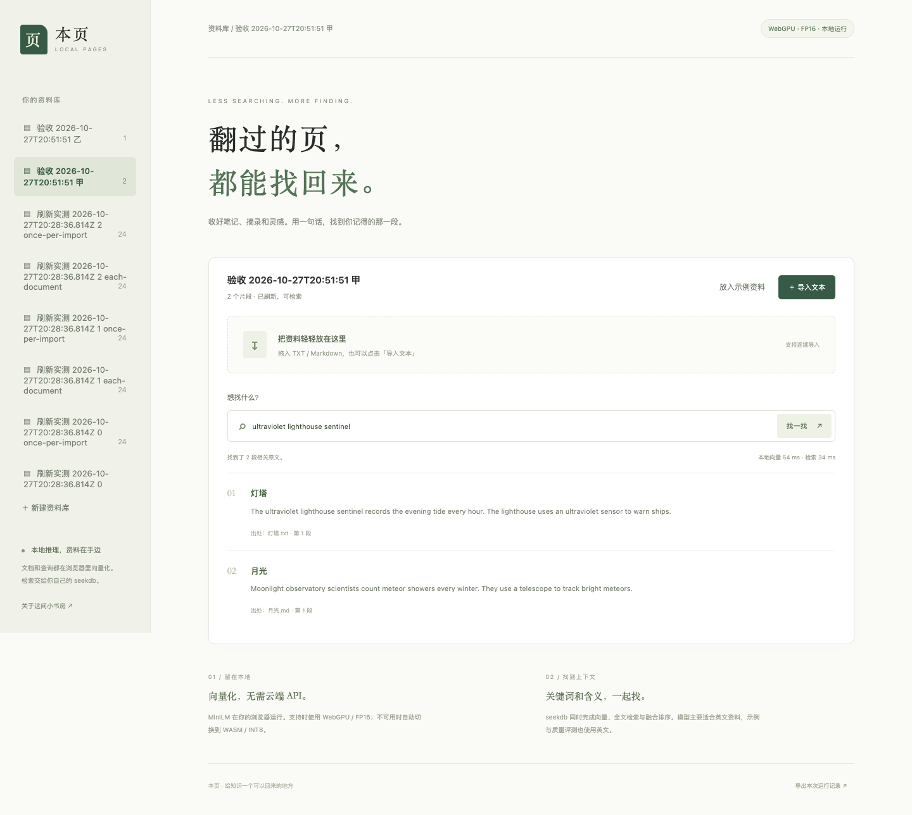

# 本页 · Local Pages

浏览器本地理解文档，seekdb 找到原文。支持 TXT/Markdown 导入、连续追加、去重、多个资料库、语义与全文融合检索，以及 WebGPU → WASM 自动降级。无需模型账号或推理 API Key。

这是 2026 生态赛题「阶跃星辰」作品。模型计算发生在浏览器 Worker；Node 只接收浏览器算出的 384 维向量，通过 **seekdb-js 1.4.0** 存储和检索。



## 启动

需要 Node.js 20.19+ 或 22.12+、pnpm 9+、Python 3.10+（仅下载模型）和 seekdb 1.4+。Chrome/Edge 需要安全上下文；本地 `http://127.0.0.1` 可直接运行。远程访问需配置 HTTPS。

### 1. seekdb

已有实例可直接使用，设置下文连接环境变量。新环境可在 Ubuntu 24.04 x86_64（建议 2 核、6 GiB、20 GiB 可用磁盘）执行：

```sh
sudo apt-get update
sudo apt-get install -y curl ca-certificates libaio1t64
sh install-seekdb-ubuntu.sh
SEEKDB_BINARY="$PWD/.seekdb-package/usr/bin/seekdb" sh start-seekdb.sh
```

安装脚本下载官方固定版本 deb，核对 SHA-256 后仅解包到本目录，不覆盖系统安装；启动脚本使用独立 `.seekdb-data`。默认 SQL 端口 2881，保持此终端运行。其他 Linux 发行版/架构请安装 [官方对应版本](https://www.oceanbase.ai/docs/quick-start)。Mac/Windows 可连接本地 Linux 虚拟机中的 server，并转发 SQL 端口。

### 2. 下载模型、构建和启动

在 `stepfun` 目录执行：

```sh
pnpm install --frozen-lockfile --ignore-scripts
python3 download_models.py
pnpm run build
SEEKDB_HOST=127.0.0.1 SEEKDB_PORT=2881 pnpm start
```

打开 **http://127.0.0.1:8788/**。先点「放入示例资料」，再搜索 `How can I make database queries faster?`，或导入自己的 TXT/Markdown。模型主要适用于英文，界面和文件名支持中文。

可用环境变量见 `.env.example`，通过 shell 设置；程序不会自动读取 `.env`。默认 root/空密码适用于独立本机演示，现有数据库请使用其实际用户和密码。`SEEKDB_DATABASE` 默认 `stepfun_pages`，程序创建专用库及集合。Node 仅绑定 127.0.0.1，不把数据库密码发给浏览器。

网络需要代理时，只给下载命令设置 `MODEL_DOWNLOAD_PROXY=http://127.0.0.1:你的端口`。运行阶段模型、Tokenizer、ONNX Runtime 全从本地静态目录读取，禁止远程模型回退。`download_models.py` 会核对固定版本的七个文件；模型不存入 Git。初始化下载三种精度合计约 159 MB，另有运行时文件；每次运行只加载选定精度。

## 使用与实现

- 拖入或选择 TXT/MD，按 1400 字符切片；同名同内容同片段 SHA-256 ID 保持稳定，重复导入采用 upsert。
- Worker 通过 Transformers.js 3.8.1 / ONNX Runtime Web 执行 mean pooling + L2 normalization，最大 128 tokens，默认 batch=8。
- 优先 WebGPU：支持 `shader-f16` 时用 FP16，否则尝试 INT8。适配器请求 3 秒未返回、无适配器，或 GPU 模型初始化 20 秒超时/失败时自动 WASM/INT8；界面显示实际后端。`?wasm=1` 可强制验证降级。
- 文档和查询均经同一个 Worker、本地模型与相同预处理生成向量。不同配置的评测使用独立集合，避免混入其他精度的数据。
- `Schema` 使用 384 维 cosine HNSW + `space` 全文索引，`embeddingFunction:null` 明确关闭 SDK 服务端/默认向量化。
- 每批写完后 `refresh_index()` 一次，完成后才更新数量并允许检索。`Collection.hybridSearch()` 在 seekdb 内执行两路候选召回与 RRF（window=20、constant=60、top=5）；前端没有两路结果拼接或内存向量搜索。全文查询先去除常见英文疑问词，语义向量保留完整问题。
- 资料库标题和模型版本也保存在 seekdb 普通表 `local_pages_libraries`；浏览器 localStorage 只存选中的集合名，页面重载后重新读真实数量。导入/切库/搜索期间锁住交互，数据库操作队列避免 SDK 会话变量并发串扰。
- 本服务拒绝来自其他 Origin 的 API 操作，单次请求上限 16 MiB、每批最多 500 片段，向量维度和有限数值在写库前检查。

## 真实测量

Apple M5 / 24 GiB，macOS；Chrome for Testing 151.0.7922.34，实际 Apple Metal-3 WebGPU。seekdb 1.4.0 server 位于 UTM Ubuntu 24.04.5 x86_64 仿真机，2 vCPU / 6 GiB，通过本机 SSH 端口转发连接；另有 ARM VM 以两个编译任务运行。**数据库延迟包含该仿真与连接开销，不等于原生 Linux 性能。**

固定 24 篇原创英文文档、6 条人工标注查询，数据和标签见 `sample-data.js`。每配置四轮：第一轮单列冷推理，后三轮报告中位数。模型加载使用独立浏览器 context；`modelFetchMs` 为本地模型资源读取时间，`loadMs` 包含该读取和运行时初始化，不是公网下载时间。

| 配置 | 文档向量化 ms / 24篇 | 吞吐 篇/s | 查询向量 ms | seekdb 检索 ms | 查询端到端 ms | Recall@5 / nDCG@5 |
|---|---:|---:|---:|---:|---:|---:|
| FP32 WebGPU，batch 1 | 175.58 | 136.69 | 9.45 | 32.64 | 62.94 | 1.000 / 0.9866 |
| FP16 WebGPU，batch 1 | 166.96 | 143.75 | 9.99 | 27.35 | 57.83 | 1.000 / 0.9866 |
| FP16 WebGPU，batch 8 | 75.70 | 317.02 | 11.28 | 27.32 | 60.37 | 1.000 / 0.9866 |
| INT8 WASM，batch 8 | 443.92 | 54.06 | 14.70 | 27.11 | 60.62 | 1.000 / 0.9866 |

FP16 相对 FP32 在相同 batch=1 条件下文档向量化下降 4.9%；仅把 FP16 batch 从 1 改为 8 下降 54.7%。组合后下降 56.9%，吞吐约 2.32 倍。小数据集质量相同，不据此推断其他语料也无损。查询端到端计时从提交查询开始，到本地向量、HTTP、数据库和 JSON 结果准备完成，包含传输和调度；不包含最终 DOM 绘制。

| 模型精度 | ONNX 字节 | ONNX + 公共配置/Tokenizer 总字节 | 相对 FP32 总体压缩比 |
|---|---:|---:|---:|
| FP32 | 90,387,606 | 91,100,408 | 1.000× |
| FP16 | 45,297,825 | 46,010,627 | 1.980× |
| INT8 | 22,972,370 | 23,685,172 | 3.846× |

使用公开仓库已导出的 FP16 浮点权重转换版与 INT8 权重量化版，不声称本队重新训练或量化。总字节的公共部分是同一份 config、tokenizer、tokenizer_config、special_tokens_map；不把运行时 JS/WASM 算作模型权重。完整哈希见 `evidence/model-files.json`。

刷新策略另做三轮对照，浏览器只生成一份向量，两种策略使用完全相同的向量和 24 篇语料、新建空集合：逐文档刷新 24 次，端到端中位数 **15,573.23 ms**；整批刷新 1 次，**1,033.65 ms**，下降 **93.4%**。这项只测写入和刷新，排除向量化。

## 复现验收

应用启动后：

```sh
mkdir -p .qa-tools
pnpm --dir .qa-tools add --ignore-scripts playwright@1.62.1
pnpm --dir .qa-tools exec playwright install chromium
export PLAYWRIGHT_MODULE="$PWD/.qa-tools/node_modules/playwright"
node verify-browser.mjs
node verify-state.mjs
node benchmark.mjs
node benchmark-refresh.mjs
```

也可把 Playwright 安装在单独工具目录，设置 `PLAYWRIGHT_MODULE=/绝对路径/node_modules/playwright`，避免修改提交依赖锁。Apple Silicon 的自动化 Chromium 使用 `--use-angle=metal` 访问真实 GPU；普通桌面浏览器按自身设置选后端。`verify-state.mjs` 的无 GPU 对照需要默认 headless 环境没有可用适配器；它会核实条件而不会把手动强制 WASM 冒充无 GPU 环境。Edge 156 也已完成真实 WASM 导入、检索和界面结果验收，见 `evidence/edge/smoke.json`；该版本 headless 截图在本机超时，视觉验收使用 Chrome，未冒称 Edge 截图通过。Edge 可设置 `BROWSER_CHANNEL=msedge` 后运行 `verify-browser.mjs`，也可用 `BROWSER_EXECUTABLE` 指定独立浏览器可执行文件。

原始数据：`evidence/benchmark/raw.json`（四配置、每配置四轮，含首次/后续、写入/刷新分段计时）、`evidence/refresh/raw.json`（刷新策略三轮）。功能证据：`evidence/state/acceptance.json`，包括 UI 连续/多文件导入/去重、两库隔离、刷新可见、页面重载、手机布局、非法维度、真实无 GPU 自动降级；请求记录证明没有外部推理或运行时网络请求。截图来自实际运行。

模型：[Xenova/all-MiniLM-L6-v2](https://huggingface.co/Xenova/all-MiniLM-L6-v2/tree/751bff37182d3f1213fa05d7196b954e230abad9)，固定 revision `751bff37182d3f1213fa05d7196b954e230abad9`，Apache-2.0；原模型 [sentence-transformers/all-MiniLM-L6-v2](https://huggingface.co/sentence-transformers/all-MiniLM-L6-v2)。一页技术说明见 [TECHNICAL.md](TECHNICAL.md)。
